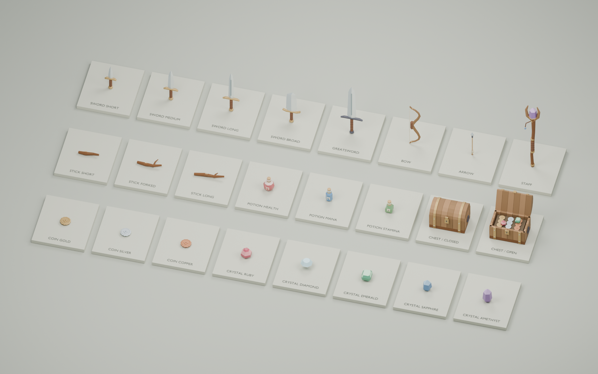

# Loot and player equipment



Built and inspected through Blender MCP. Matches the existing flat-faceted,
texture-free clay style: warm timber, leather wraps, muted brass and steel,
soft gemstone colours and opaque stylised potion glass.

## Assets

| Group | Named variants |
|---|---|
| Wooden sticks | `item_stick_short`, `item_stick_forked`, `item_stick_long` |
| Coins | `item_coin_gold`, `item_coin_silver`, `item_coin_copper` |
| Crystals | `item_crystal_ruby`, `item_crystal_diamond`, `item_crystal_emerald`, `item_crystal_sapphire`, `item_crystal_amethyst` |
| Swords | `weapon_sword_short`, `weapon_sword_medium`, `weapon_sword_long`, `weapon_sword_broad`, `weapon_sword_greatsword` |
| Ranged equipment | `weapon_bow`, `weapon_arrow` |
| Staff | `weapon_staff` (forked wood, brass collars, amethyst head) |
| Potions | `item_potion_health` (red, round), `item_potion_mana` (blue, tall), `item_potion_stamina` (green, square) |
| Treasure chest | `treasure_chest_closed`, `treasure_chest_open` (with coins and gems) |

**24 assets / 9,232 triangles total.** The two chest states are separate static meshes,
not animated. Sticks vary in length and branching; gemstones have distinct cuts;
swords vary in blade length, width, guard and grip, not just scale.

## Files

- `../items.py`: deterministic source; uses sibling `props.py` and `town.py` helpers.
- `../items.blend`: editable, labelled showroom with camera and lighting.
- `../items.glb`: complete library, all 24 named roots at the origin.
- `<name>.glb` and `<name>.png`: standalone exports and individual previews.
- `manifest.json`: names, triangles, authoring bounds, sizes and unit/scale contract.
- `../items-preview.png`: overview render.
- `../test_items.py`: geometry, repeatability and actual binary GLB validation.

Every asset is one flat-shaded Blender mesh, with vertex colours, baked geometry,
and no textures, UVs, rigs, animation, modifiers or external dependencies.
There are up to three material primitives (clay, metal, gemstone/glass); a glTF
loader may expose a root group with multiple mesh children. Keep that root when
instancing or attaching equipment. Preview plinths, labels, lights and floor
are excluded from all GLBs.

## Units and pivots — important

Export is **Y up**, with Blender `(x, y, z)` mapped to glTF `(x, z, -y)`.

- **Loot and chests:** one unit = one game cell; `game_scale=1`. Origins are
  ground-centred, with exported ground at Y=0. Front is glTF +Z.
- **Weapons and arrow:** use the same unscaled rig units as `character.py` /
  `sword.py`. `game_scale=.55` when placed directly in the game world. When
  attached under the already-scaled character, keep local scale **1**, not .55.
- **Swords/staff/bow:** origins are grip centres. Sword blade / staff length
  runs along glTF +Y (Blender +Z). Swords match the existing `hand.R` / `Slash`
  attachment convention, including the -π/6 grip rotation about X.
- **Bow:** `hand.L` grip socket; lies in XY after export, with +X forward.
  Its string-centre nock point is `[-.072, 0, 0]` in exported local space.
  Aim orientation needs to be set by the game, not inferred from global +Z.
- **Arrow:** origin is the nock, not a grip; glTF +Y points towards its head.
  Rotate to match the shot direction when placing on the bow or firing.
- Blender bone parenting is bone-tail-relative: when attaching directly to the
  rig in Blender, apply the same tail compensation as `sword.attach()`.

GLB extras include `cube_crawler_item`, `category`, `attach`, `units`,
`game_scale`, `blocking`, `radius`; equipment adds `weapon`, `socket`, axis
and grip hints. Potions add `potion_type`; chests add `state`. These are metadata,
not implemented inventory effects, collision or combat rules.

The assets are **not wired into gameplay**; the original embedded player sword
and existing game behaviour are unchanged.

## Rebuild / validate

```sh
Blender --background --python blender/items.py -- blender
Blender --background --python blender/test_items.py
```

Via the interactive Blender MCP execute tool:

```python
import sys, importlib
sys.path.insert(0, '/absolute/path/to/dungeon-crawler/blender')
import items
importlib.reload(items)
items.main(render=False)  # saves .blend and combined + individual GLBs
```

Default `main()` also renders the overview and 24 individual previews. Tests
run in an isolated Blender process and export only into a temporary directory.
They check deterministic geometry/colours, triangle budgets, flat normals,
nondegenerate triangles, ground/grip/nock pivots, Y-up bounds, named roots,
extras, no preview objects/textures/UVs, and selection/visibility/layout
restoration after exporting.
