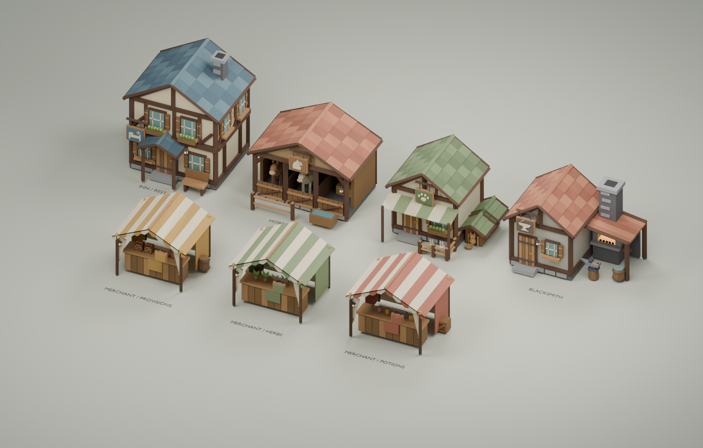

# Town service models



Seven texture-free, flat-shaded models using the existing `props.py` mesh builder,
vertex-colour material, neutral masonry, warm timber and muted meadow colours.
Large pitched roofs and raised pictogram signs keep services readable at game scale.

| Asset | Features | Triangles |
|---|---|---:|
| `town_merchant_a` | Ochre/cream tent, provisions, pottery, barrel, coin sign | 1,906 |
| `town_merchant_b` | Sage/cream tent, herbs, crate, leaf sign | 1,486 |
| `town_merchant_c` | Rust/cream tent, potion bottles, crate, bottle sign | 1,692 |
| `town_inn_a` | Two-storey half-timber inn, bed/healing sign, porch, bench, flower boxes | 3,588 |
| `town_stable_a` | Three stalls, two horses, hay, hitching rail, trough, horse sign | 2,730 |
| `town_pet_shop_a` | Paw sign, striped awning, rabbit pen, cat, kennels, bird perch | 3,688 |
| `town_blacksmith_a` | Open forge, emissive coals, chimney, anvil/hammer, bellows, quench tub | 2,622 |

## Files

- `../town.py`: reproducible procedural source; depends on sibling `props.py`.
- `../town.blend`: editable showroom with all seven assets, camera and lighting.
- `../town.glb`: combined asset library; each named root is at the origin.
- `<asset>.glb`: standalone model; `<asset>.png`: individual preview.
- `../town-preview.png`: overview render.
- `manifest.json`: triangle counts, dimensions, authoring bounds and service hints.

## Game contract

- **1 unit = 1 game cell.** Use scale 1; the game's character is approximately 1.1 units tall.
- Blender: Z up, front -Y. Export: **Y up, front +Z**. Ground is Y=0 in glTF.
- Origins are at the main building's ground-centred footprint, not the centre of attached props.
  Bounds include barrels, porches, fences, kennels and workshop attachments.
- Each Blender asset is one mesh with flat normals and baked geometry; no textures, UVs,
  modifiers, rigs or animation. Each GLB root has two material primitives: vertex colour
  and emissive lantern/forge. A loader may therefore expose a group with two mesh children.
- Extras: `service`, `stock`, `variant`, `attach`, `blocking`, `radius`, `footprint`,
  `height`, `light`, `intensity`, `units`, `front`, `cube_crawler_town`.
- `light`/`intensity` are optional runtime lighting hints, not exported light objects.
- Showroom positions, labels, floor, camera and lights are excluded from every GLB.

These are **exterior visual assets only**. The game now places all seven in the
starting town, with non-interactive footprint box colliders and a reserved walking
layout. Sleeping/healing, trading, pet ownership and horse interactions are not
implemented. Animals are static decoration joined into the buildings.
Buildings are wider than the one-cell scatter props; they are placed explicitly,
not randomly through the decoration generator. `radius` is a spacing hint, not a collider.

The surrounding grove uses three larger trees from `../town_trees.glb`, generated
by `../town_trees.py` (editable source `../town_trees.blend`, preview
`../town_trees-preview.png`). These are 6–7 units tall, with broad faceted crowns.
Their `trunk_radius` / `trunk_height` metadata distinguishes collision from foliage;
canopies overhang paths and are handled by the player's cutaway. The town plan
and safety rules live in `mockup/src/world/town.js`; see `mockup/docs/world.md`.

## Rebuild / validate

From the repository root (replace `Blender` with your executable):

```sh
Blender --background --python blender/town.py -- blender
Blender --background --python blender/test_town.py
```

The build exports before laying out the showroom. Tests check all seven meshes,
deterministic rebuilds, triangle budgets, flat shading, ground pivots and the actual
combined/individual GLBs: Y-up bounds, named roots, vertex colours, emissive materials,
service extras, no unwanted preview objects, and restoration of preview positions.
